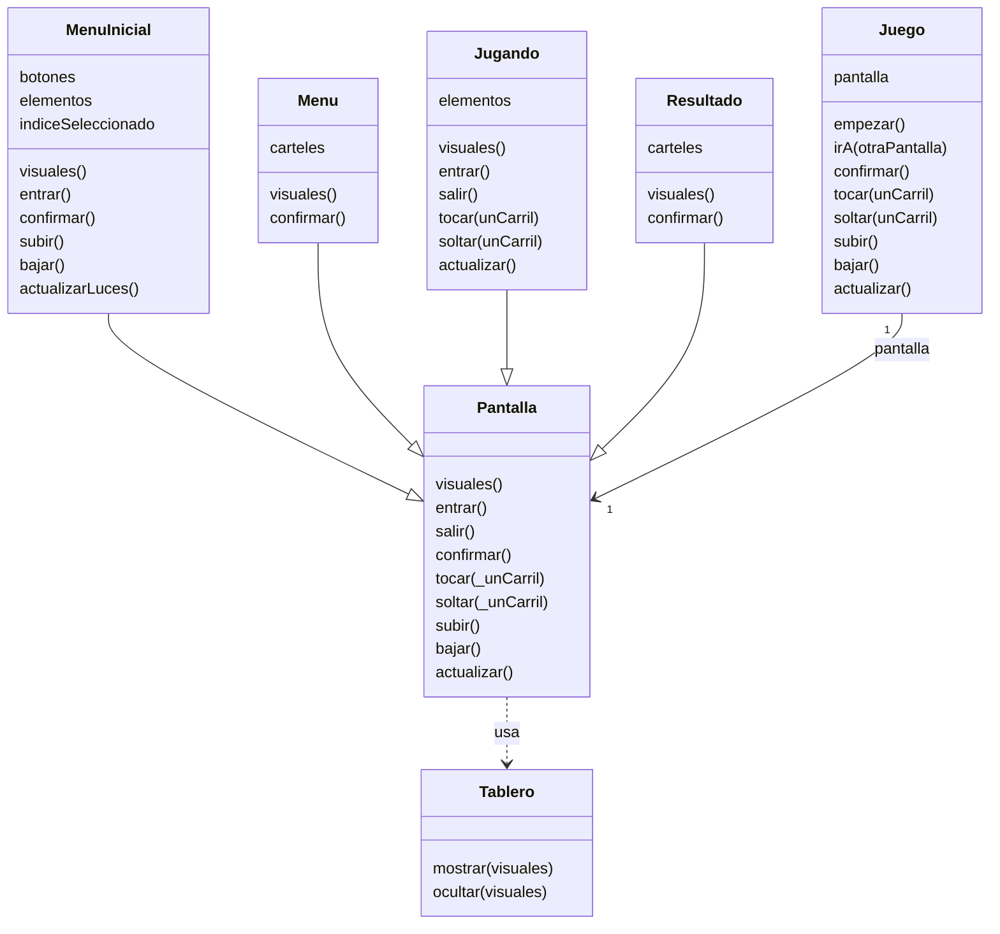
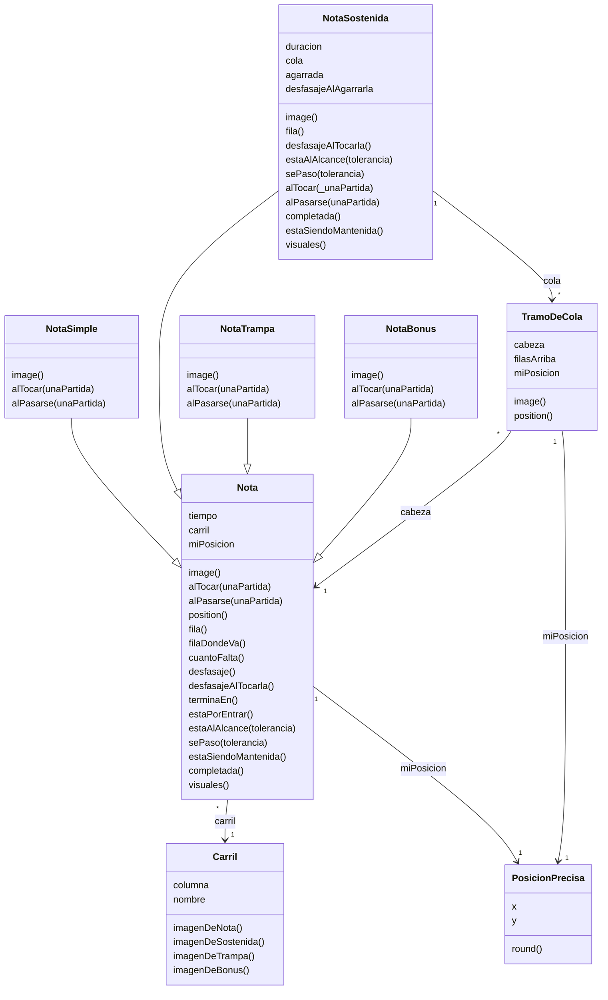
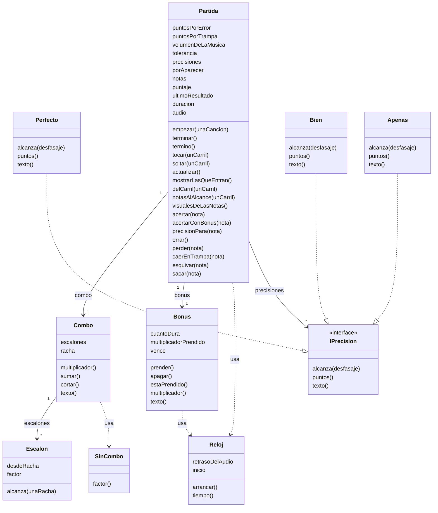
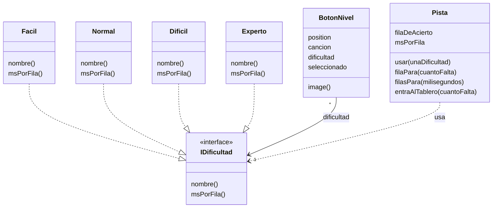

# Diagrama de clases

Los diagramas están armados en Mermaid respetando las reglas de UML estricto para mostrar la estructura estática del sistema. 
Se modelan las clases e interfaces que definen los contratos del sistema, 
por lo que los objetos WKO (Well Known Objects) de Wollok fueron representados por sus clases implícitas en mayúscula.

## Las pantallas

El juego es una máquina de estados: siempre hay una pantalla activa y el objeto `Juego` le delega todo. 
Entrar y salir del tablero es igual para todas, así que ese comportamiento vive en la superclase `Pantalla`; 
las teclas no hacen nada por defecto y cada pantalla redefine solo las que le importan. 
Cambiar de pantalla es cambiar el objeto al que le hablamos, por eso no hay ningún `if` que pregunte en qué pantalla estamos.

## Las notas

El corazón del diseño. La clase abstracta `Nota` sabe lo que tienen en común todas: en qué momento pasan, por qué carril bajan y dónde se dibujan.
Lo que cambia entre una y otra es qué pasa cuando la tocás y qué pasa si se te escapa, y eso lo decide cada subclase (`NotaSimple`, `NotaSostenida`, `NotaTrampa`, `NotaBonus`).
La partida las trata a todas igual gracias al polimorfismo, nunca pregunta de qué clase es cada una.

## El puntaje

`Partida` lleva las reglas. Cuánto vale un acierto sale de dos lados: qué tan justo le pegaste (las precisiones: `Perfecto`, `Bien` o `Apenas`) 
y la racha que traías (`Combo`). `Perfecto` es hasta 40 ms y vale 150, `Bien` hasta 90 y vale 100, y `Apenas` acepta cualquier desfasaje 
que haya entrado en la tolerancia de 160 ms y vale 50. Ni las precisiones ni los escalones del combo comparten una superclase concreta: 
son objetos independientes que entienden los mismos mensajes (cumplen la misma interfaz), así que agregar un nivel de precisión nuevo es agregar un objeto a una lista y no tocar ningún `if`.
Encima de eso, la nota amarilla prende el `Bonus`, que mientras dura multiplica por dos lo que sumes.

    
## Las dificultades

Cada nivel del menú elige con qué dificultad se juega, y la `Pista` toma de ahí cuántos milisegundos entran en cada fila del tablero:
cuantos menos, más rápido bajan las notas. Las cuatro dificultades tampoco comparten superclase, cumplen la misma interfaz.

## Donde esta cada cosa

| Archivo | Que tiene |
| --- | --- |
| `nota.wlk` | `Nota` y sus cuatro subclases, mas `TramoDeCola` |
| `pista.wlk` | `pista`, `Carril`, `Receptor` y `PosicionPrecisa` |
| `juego.wlk` | `juego`, `Pantalla` y las cuatro pantallas |
| `partida.wlk` | Las reglas y el puntaje |
| `combo.wlk` | `combo`, `Escalon` y `sinCombo` |
| `bonus.wlk` | El x2 que prende la nota amarilla |
| `precision.wlk` | `perfecto`, `bien`, `apenas` y los avisos de error |
| `dificultad.wlk` | Las cuatro velocidades de los niveles del menu |
| `visuales.wlk` | `Cartel`, `Marcador`, `Muestra`, `BotonNivel` y los banners |
| `canciones.wlk` | Las canciones disponibles y sus notas, generadas desde charts o audios |
| `reloj.wlk` y `sonido.wlk` | El tiempo y la musica, separados para poder testear |
| `tablero.wlk` | Poner y sacar visuales |

## Decisiones de Diseño en UML Estricto
Para la confección de estos diagramas se priorizó el estándar de la cátedra, tomando las siguientes decisiones formales:
- Objetos WKO modelados como Clases: el diagrama de clases sirve para mostrar el diseño general de una solución de manera estática, mientras que un diagrama de objetos es una foto del sistema en un momento determinado. Dado que los diagramas de clases no admiten instancias, los objetos definidos con `object` en Wollok (que en realidad son instancias únicas de clases anónimas) se documentaron explicitando esa clase subyacente (por ejemplo, modelando `partida` como la clase `Partida` o `perfecto` como la clase `Perfecto`).   La interfaz
- IPrecision: los niveles de precisión en el código comparten un comportamiento, pero dicho comportamiento no requiere de una superclase. En este escenario, UML propone definir un concepto llamado interfaz, estableciendo una relación de realización donde las clases (como `Perfecto` o `Bien`) implementan las operaciones definidas en ella. Aunque Wollok maneja esto implícitamente por Duck Typing sin declarar explícitamente las clases que lo implementan, incluir la `IPrecision` en el diagrama es la forma correcta de graficar y comunicar este polimorfismo. 
